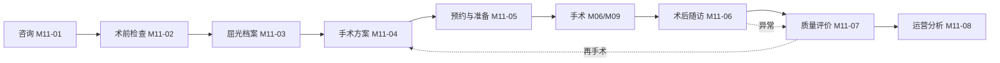
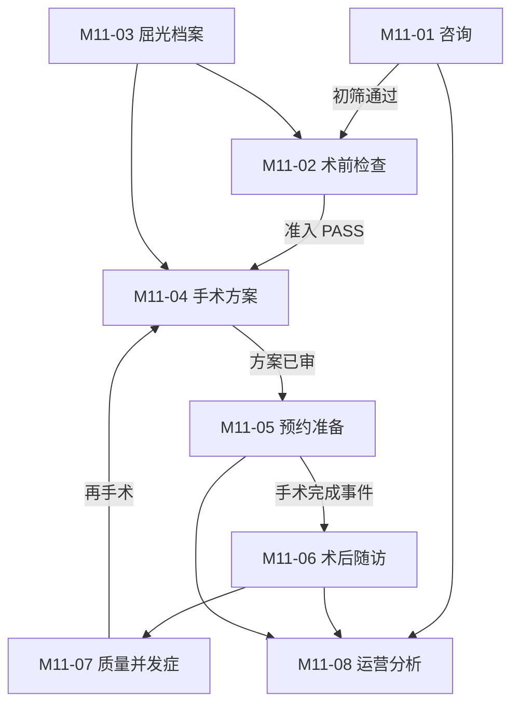

# 二级眼科医院 HIS 系统 — M11 屈光手术管理
# 模块详细设计（总纲）

**文档版本：** V1.0
**所属模块：** M11 屈光手术管理（Refractive Surgery Management）
**设计依据：** 《二级眼科医院HIS系统总体功能模块设计》第 4.3 / 5.4 / 6 / 8.2 节、[M11 共享规范](00_M11_屈光手术管理_模块设计_共享规范与文档模板.md)、[M01-07 手术主数据](../M01主数据管理MDM/M01_主数据管理MDM_07_手术_详细设计.md)、[M06 日间手术管理](../M06日间手术管理/M06_日间手术管理_详细设计.md)、[M09 手术麻醉管理](../M09手术麻醉管理/M09_手术麻醉管理_详细设计.md)、[M10 视光业务管理](../M10视光业务管理/M10_视光业务管理_详细设计.md)、[M16 收费结算管理](../M16收费结算管理/M16_收费结算管理_详细设计.md)
**技术栈：** Python 3.11+ / FastAPI / SQLAlchemy 2.0 / PostgreSQL 16 / Redis 7 / Celery / APScheduler / Pydantic V2 / Alembic
**文档用途：** M11 模块总纲。说明八个子模块的划分依据、数据流、状态机、全局契约与建设顺序。**各子模块的实现细节见对应的 2 个文件。**

---

## 目录

1. [模块定位与价值](#1-模块定位与价值)
2. [八子模块划分](#2-八子模块划分)
3. [六条拆分主线](#3-六条拆分主线)
4. [屈光闭环与五道闸门](#4-屈光闭环与五道闸门)
5. [三套状态机](#5-三套状态机)
6. [全局规模总览](#6-全局规模总览)
7. [五条铁律](#7-五条铁律)
8. [内部契约总线](#8-内部契约总线)
9. [上游依赖全景](#9-上游依赖全景)
10. [跨模块事件全景](#10-跨模块事件全景)
11. [建设顺序与依赖](#11-建设顺序与依赖)
12. [验收总要求](#12-验收总要求)

---

## 1. 模块定位与价值

### 1.1 一句话定位

> **M11 回答「这个近视患者能不能做屈光手术、该做哪种术式、角膜切削多少、晶体选多少度、什么时候做、做完恢复得怎么样」。**

M11 是眼科医院**客单价最高的业务线**。飞秒 SMILE 单眼 8,000~15,000 元、ICL 单眼 15,000~25,000 元，一台双眼 SMILE 手术的收入相当于 40~60 副普通框架眼镜。

与 M10 视光业务相比：

| 维度 | M10 视光 | M11 屈光 |
|---|---|---|
| 收入特征 | 高频、低客单、现金流即时 | 低频、高客单、咨询周期长 |
| 决策链 | 顾客即决策者 | 咨询师 → 医师 → 患者多方决策 |
| 核心数据 | 屈光度（配镜参数） | 角膜条件（手术可行性） |
| 风险等级 | 低（可退换） | **高（不可逆医疗行为）** |
| 质量要求 | 商品质量 | **医疗质量（有效性/安全性/稳定性/可预测性）** |

### 1.2 为什么屈光业务必须独立成模块

**理由一：决策依据完全不同——「配多少度」vs「能不能做、切多少」。**

M10-02 配镜处方只需要验光度数 + 瞳距，规则是「度数怎么换算」。M11-04 手术方案需要：角膜地形图（排除圆锥角膜）、角膜中央厚度（决定切削上限）、角膜内皮细胞计数（决定 ICL 安全性）、前房深度（决定 ICL 型号）、暗瞳直径（决定光学区）、泪膜破裂时间（决定术后干眼风险）。这是**完全不同的数据集合**，塞进 M10 只会让 M10 的验光表膨胀出几十个与配镜无关的字段。

**理由二：合规与追溯要求最高——屈光手术是不可逆医疗行为。**

一旦切削角膜，无法恢复原状。因此：

- 术前必须留档完整原始数据（地形图原图、厚度测量原始曲线），不能只存结论
- 手术方案必须版本化，签署后不可修改，只能作废重开
- 知情同意必须与方案版本绑定，能追溯「患者签字时看到的是哪一版方案」
- 并发症必须上报闭环，不可删除

这些要求与 M10 的商品销售、会员营销是两种性质。

**理由三：流程长度是 M10 的 3 倍——从咨询到术后 2 年。**

M10 视光闭环 9 步，通常一次到店 2~4 小时内完成。M11 屈光闭环从首次咨询到术后 2 年随访结束，跨 **8~12 次到院**、**24 个月**：

```
咨询(30min) → 术前检查(2~3h) → 出方案(1~3天) → 预约(1~4周等待)
→ 手术日(2h) → D1 → W1 → M1 → M3 → M6 → Y1 → Y2
```

这么长的周期需要独立的档案与随访体系。

**理由四：运营视角独立——屈光中心是独立核算单元。**

屈光中心通常独立核算，有独立咨询师、独立手术室、独立价格策略，M11-08 提供咨询转化漏斗、术式占比、咨询师业绩、渠道效果分析，M10 的视光会员体系无法覆盖这些。

### 1.3 与五个相邻模块的边界

| 问题 | 权威方 | M11 的关系 |
|---|---|---|
| 屈光术式有哪些、分级、医师授权、术前检查项、随访规则 | **M01-07 手术主数据** | **只读**，开方案前调 `full-config` 与 `auth/check` |
| 手术什么时候做、哪个手术间、术中记录、麻醉、植入物扫码 | **M06 / M09** | **只读**，M11 只写预约与术前准备 |
| 验光结果、视力健康档案、配镜史 | **M10 视光** | **只读**（P-01 / P-02 / P-25） |
| 收了多少钱、方案定价、退款、发票 | **M16 收费结算** | **只读**，M11 不碰钱 |
| **能不能做、切削多少、晶体度数、术后效果** | **M11（本模块）** | ✅ **唯一权威** |

> **一句话记忆：** M01 定义「有哪些术式」，M06/M09 定义「手术怎么开」，M10 定义「眼睛原本什么状态」，M16 定义「钱」，**M11 定义「这个人适不适合做、做成什么样」**。

---

## 2. 八子模块划分

| 编号 | 子模块 | 核心职责 | 核心表前缀 | 页 | 表 | 接口 | 内部契约 |
|---|---|---|---|---|---|---|---|
| **M11-01** | 屈光咨询与转化 | 咨询接待、意向、初筛、渠道、回访、转化漏斗 | `m11_consult_` | 8 | 6~8 | 28~34 | P-11 |
| **M11-02** | 术前检查与准入评估 | 检查套餐、地形图、厚度、内皮、禁忌筛查、准入判定 | `m11_preop_` | 9 | 8~10 | 30~38 | P-10 |
| **M11-03** | 屈光档案 | 一患一档、术前基线、手术史、时间轴、合并纠错 | `m11_refractive_` | 8 | 7~9 | 26~32 | P-02 / P-03 |
| **M11-04** | 手术方案与切削计算 | 术式选择、切削参数、晶体度数、方案审核 | `m11_plan_` / `m11_iol_` | 9 | 9~11 | 30~38 | P-01 / P-04 / P-05 / P-06 |
| **M11-05** | 手术预约与术前准备 | 排程申请、术前用药宣教、知情同意、核对交接、停台改期 | `m11_reservation_` | 8 | 8~10 | 26~32 | P-07 / P-08 / P-09 |
| **M11-06** | 术后随访与视力追踪 | 随访节点、术后检查、追踪曲线、四项指标 | `m11_postop_` | 9 | 8~10 | 30~36 | P-12 / P-13 |
| **M11-07** | 屈光质量与并发症管理 | 质控指标、并发症分级、不良事件闭环、再手术 | `m11_complication_` / `m11_quality_` | 8 | 7~9 | 24~30 | P-14 |
| **M11-08** | 屈光运营与转化分析 | 转化漏斗、术式占比、医师业绩、渠道分析 | `m11_refractive_stat_` | 8 | 5~7 | 20~26 | P-15 |
| **合计** | — | — | — | **67** | **58~74** | **214~266** | **15** |

---

## 3. 六条拆分主线

八子模块不是按「功能列表」切的，而是按**六条主线**切的。理解这六条，任何新增功能都能找到归属：

### 主线一：患者旅程（纵向）

```
咨询 → 检查 → 档案 → 方案 → 预约 → 手术 → 随访 → 质量
M11-01  M11-02  M11-03  M11-04  M11-05  M06/09  M11-06  M11-07
```

这是最主要的主线。**每个子模块对应患者旅程的一个阶段**，边界的判据是「这个阶段的操作者是谁、在哪台电脑上做」。

### 主线二：数据性质（横切）

| 数据性质 | 归属 | 理由 |
|---|---|---|
| 意向与沟通过程数据 | M11-01 | 只增、可频繁修改、与医疗无关 |
| 检查原始数据（图像/曲线） | M11-02 | 不可改、需长期留档、需专业判读 |
| 患者终身档案（一档） | M11-03 | 一患一档、跨年度、被所有子模块引用 |
| 决策依据与结论 | M11-04 | 版本化、签署锁定、需审核 |
| 执行约定 | M11-05 | 有明确生命周期、可与 M06/M09 同步 |
| 效果评价数据 | M11-06 | 时间序列、需计算派生指标 |
| 风险与质量数据 | M11-07 | 只增流水、不可删除、需上报 |
| 聚合统计 | M11-08 | 派生数据、可重建、不影响业务 |

### 主线三：操作者与工作台

| 操作者 | 主要子模块 | 工作台 |
|---|---|---|
| 咨询师 | M11-01 | 屈光咨询工作台 |
| 检查技师 | M11-02 | 术前检查工作台 |
| 屈光医师 | M11-02 / M11-03 / M11-04 / M11-06 | 医师站内嵌 |
| 主刀医师 | M11-04 / M11-07 | 方案工作台 / 质控主页 |
| 护士 | M11-05 | 手术预约工作台 |
| 运营/院领导 | M11-08 | 屈光运营看板 |

### 主线四：时间维度

| 时间跨度 | 子模块 |
|---|---|
| 单次会话（分钟级） | M11-01 咨询谈话 |
| 单次就诊（小时级） | M11-02 术前检查 |
| 单次决策（天级） | M11-04 手术方案 |
| 单次事件（术前 1~4 周） | M11-05 预约与准备 |
| 长期跟踪（术后 2 年） | M11-06 术后随访 |
| 终身档案（跨年） | M11-03 屈光档案 |
| 周期性统计（日/月/季） | M11-07 / M11-08 |

### 主线五：变更频率

| 变更频率 | 子模块 | 设计影响 |
|---|---|---|
| 极高（每次沟通都改） | M11-01 | 宽表、少约束、日志表 |
| 中（每次就诊改） | M11-02 / M11-06 | 主档 + 明细 |
| 低（一次定稿） | M11-04 / M11-05 | 版本化、签署锁定 |
| 极低（一次建档） | M11-03 | 主档 + 变更日志 |
| 只增不改 | M11-07 | 只增流水 |

### 主线六：合规要求强度

| 合规强度 | 子模块 | 具体要求 |
|---|---|---|
| **最高**（医疗安全） | M11-02 / M11-04 / M11-05 / M11-07 | 不可篡改、签署锁定、完整留痕、上报闭环 |
| 中（隐私） | M11-01 / M11-03 / M11-06 | 手机号脱敏、导出审计 |
| 低（运营） | M11-08 | 脱敏聚合、无个人明细 |

---

## 4. 屈光闭环与五道闸门

### 4.1 屈光闭环



### 4.2 五道闸门（强制校验点）

M11 在闭环上设了**五道闸门**，每道闸门不通过就无法进入下一环节：

| 闸门 | 位置 | 校验内容 | 不通过的错误码 |
|---|---|---|---|
| **闸门一：初筛** | 咨询 → 术前检查 | 年龄 ≥ 18（特殊需监护人同意）、度数稳定 ≥ 2 年（年变化 ≤ 0.50D）、无绝对禁忌 | `"1101001"` 或 `"1101002"` |
| **闸门二：准入** | 术前检查 → 出方案 | 角膜厚度 ≥ 480μm（SMILE）、地形图排除圆锥角膜、内皮细胞 ≥ 2000/mm²、眼压正常、无活动性眼病 | `"1102xxx"` |
| **闸门三：方案** | 方案 → 预约 | RSB ≥ 250μm、医师授权通过 `auth/check`、方案已审核 | `"1104xxx"` |
| **闸门四：核对** | 预约 → 手术 | 知情同意已签、眼别核对一致、术前用药已执行、方案未过期（默认 90 天） | `"1105xxx"` |
| **闸门五：随访** | 手术 → 结档 | D1 / W1 / M1 / M3 随访均已完成，无未闭环并发症 | `"1106xxx"` |

---

## 5. 三套状态机

### 5.1 咨询状态机（M11-01）

```
NEW ──将接──> CONTACTING ──初筛通过──> SCREENED ──约检查──> EXAM_BOOKED
 │                 │                                            │
 │                 └──初筛不通过──> LOST                         │ 检查到院
 │                                                              ▼
 │                                                          EXAM_DONE
 │                                                              │
 │                                                       出方案 ▼
 │                                                          PLAN_MADE
 │                                                              │
 │                                                        约手术 ▼
 │                                                       SURGERY_BOOKED
 │                                                              │
 │                                                        手术完成 ▼
 │                                                       SURGERY_DONE
 │                                                              │
 │                                                        会员转化 ▼
 │                                                          CONVERTED
 │
 └──无效──> INVALID
```

### 5.2 手术方案状态机（M11-04）

```
DRAFT ──提交审核──> PENDING_AUDIT ──审核通过──> AUDITED
  │                       │                       │
  │                       └──审核驳回──> REJECTED  │ 预约已排
  │                            │                  ▼
  │                            └──修改重提──> DRAFT   （进入手术流程）
  │
  ├──作废──> CANCELLED
  └──超过有效期(90天)──> EXPIRED

新版本产生时，旧版本 → SUPERSEDED（已被替代，只读保留）
```

### 5.3 手术预约状态机（M11-05）

```
DRAFT ──提交──> SUBMITTED ──M06 接单──> CONFIRMED ──术前准备──> PREPARING
                    │                        │                     │
                    │                        │                     ▼
                    └──取消──> CANCELLED     └──取消──> CANCELLED  READY
                                                                    │
                                                              手术开始 ▼
                                                              IN_SURGERY
                                                                    │
                                                              手术结束 ▼
                                                             SURGERY_DONE

PREPARING / READY ──改期──> POSTPONED（原预约取消 + 新建预约）
CONFIRMED ──患者未到──> NO_SHOW
```

---

## 6. 全局规模总览

| 维度 | 规模 |
|---|---|
| 子模块 | 8 |
| 文件 | 8 × 2 = **16** 份子模块文档 + 3 份模块级文档 = **19** 份 |
| 页面 | **67**（P01~P08/P09，每子模块独立编号） |
| 数据表 | **58~74** 张（前缀 `m11_`） |
| 对外接口 | **214~266** 个（`API-01` 起，每子模块独立连续） |
| 内部契约 | **14** 个（`P-01`~`P-14`，全模块唯一编号） |
| 上游依赖 | 约 **30** 个（分布在 M01/M03/M06/M09/M10/M12/M15/M16/M20） |
| 发布事件 | **9** 个 |
| 订阅事件 | **7** 个 |
| 错误码 | `"1101001"`~`"1108xxx"` + `"119001"` |

---

## 7. 五条铁律

### 铁律一：数量口径三处一致

| 对象 | 三处一致 |
|---|---|
| 页面 | 页面总览树 `P0x` = 第 5 章 `### 5.x P0x` 标题 = 附录页面清单 |
| 数据表 | 表清单 = `### 4.x 表：` 标题 = 第 4 章指引块写的 N |
| 接口 | `API-01` 起连续无断号 = 每项都有 `#### API-xx` 详述 |

### 铁律二：钱与库存都不自己算

- 金额一律调 M16（`POST /internal/v1/billing/create` 建结算单、`/billing/pay` 收款、`/m16/discount/calc` 优惠试算）
- M11 只存 M16 返回的快照，字段名带 `_snap` / `_ref` 后缀
- 人工晶体、植入物库存一律以 M15 为权威源
- **M11 不能出现任何金额运算**（乘法、加法、折扣计算都禁止）

### 铁律三：技术栈 PostgreSQL 16

禁止 MySQL 专有语法（自增列、整型别名、日期时间旧类型、表引擎声明、Oracle 字符串类型等写法，详见共享规范第 2.6 节）

必须：`BIGINT GENERATED BY DEFAULT AS IDENTITY` / `BOOLEAN` / `TIMESTAMP` / `JSONB` / `NUMERIC` / 部分索引 / `is_deleted` 逻辑删除 / 无物理外键

### 铁律四：手术记录不在 M11

M11 管「咨询 → 术前检查 → 屈光档案 → 手术方案 → 预约 → 术后随访」。
**术中执行（手术记录、麻醉记录、器械清点、植入物扫码）归 M09**，排程排班归 M06/M09。
M11 只写 `m11_surgery_reservation`（预约与术前准备）与术后随访，术中数据**只读引用**。

### 铁律五：不建第二套验光表

验光数据的**唯一来源是 M10-01**。M11 只能通过接口只读引用：

- `GET /internal/v1/m10/optometry/{optometry_no}`（M10 P-01）
- `GET /internal/v1/m10/optometry/by-patient/{patient_id}/latest`（M10 P-02）

M11 的屈光档案存的是**手术决策需要的基线快照**（角膜条件、手术史），不是验光数据副本。

---

## 8. 内部契约总线

M11 对外提供 15 个内部契约，编号 `P-01`~`P-15` 全模块唯一：

| 编号 | 方法 | 路径 | 用途 | 调用方 | SLA | 归属 |
|---|---|---|---|---|---|---|
| **P-01** | GET | `/internal/v1/m11/iol-calculation/{patient_id}` | **人工晶体理论度数（M09-05 已预留）** | M09-05 | 200ms | M11-04 |
| **P-02** | GET | `/internal/v1/m11/records/{record_no}` | 取屈光档案 | M07、M22 | 100ms | M11-03 |
| **P-03** | GET | `/internal/v1/m11/records/by-patient/{patient_id}` | 按患者取屈光档案 | M07、M12、M16-04 | 100ms | M11-03 |
| **P-04** | GET | `/internal/v1/m11/plans/{plan_no}` | 取手术方案（含切削参数） | M06、M09、M16-04 | 150ms | M11-04 |
| **P-05** | GET | `/internal/v1/m11/plans/by-patient/{patient_id}/latest` | 患者最近方案 | M06、M09、M07 | 120ms | M11-04 |
| **P-06** | POST | `/internal/v1/m11/plans/on-audited` | 方案审核结果回调 | M06 | 100ms | M11-04 |
| **P-07** | GET | `/internal/v1/m11/reservations/{reservation_no}` | 取手术预约 | M06、M09、M16-04 | 100ms | M11-05 |
| **P-08** | GET | `/internal/v1/m11/reservations/by-patient/{patient_id}` | 患者手术预约清单 | M06、M09、M07 | 120ms | M11-05 |
| **P-09** | POST | `/internal/v1/m11/reservations/on-surgery-completed` | 手术完成回调（触发随访） | M06、M09 | 150ms | M11-05 |
| **P-10** | GET | `/internal/v1/m11/preop-exams/{exam_no}/admission` | 术前准入判定结果 | M06、M09 | 100ms | M11-02 |
| **P-11** | GET | `/internal/v1/m11/consultations/{consult_no}` | 取咨询单 | M16-04、M22、M20 | 100ms | M11-01 |
| **P-12** | GET | `/internal/v1/m11/postop-followups/due` | 术后到期随访清单 | M03-04、M19 | 200ms | M11-06 |
| **P-13** | POST | `/internal/v1/m11/postop-followups/on-created` | 随访计划创建通知 | M03-04、M19 | 100ms | M11-06 |
| **P-14** | GET | `/internal/v1/m11/quality/indicators` | 屈光质量指标 | M22、M17 | 300ms | M11-07 |

> **P-01 是最重要的契约。** M09-05 已定义 U-04 消费它，用于术前晶体度数核对（理论值 vs 实际选择值，偏差须 ≤ 0.25D）。若此接口不可用，M09 降级为「跳过比对，标记未校验」，直接削弱手术安全防线。

---

## 9. 上游依赖全景

| 来源模块 | 提供的能力 | 关键接口 | 失败影响 |
|---|---|---|---|
| **M01-07 手术主数据** | 术式定义、分级、医师授权、术前检查项、随访规则 | `full-config`、`auth/check` | **阻断**（无法开方案） |
| **M01-02 职工** | 医师、咨询师、护士 | `/staff/{id}/brief` | 降级（显示 ID） |
| **M01-06 收费** | 收费项目、价格、计费试算 | `/charge/*` | 阻断（无法出报价） |
| **M03-01 患者** | 患者身份 | `/patient/{id}/brief` | 阻断 |
| **M03-03 会员** | 会员等级与权益 | `/member/*` | 降级（按原价） |
| **M03-05 消息** | 短信、微信发送 | `/message/send` | 降级（转人工） |
| **M06 日间手术** | 手术申请、排台 | `/m06/apply`、`/m06/schedule/{id}` | **阻断**（无法约台） |
| **M09 手术麻醉** | 术中状态、手术完成事件 | 事件订阅 | 告警（状态滞后） |
| **M10-01 验光** | 验光结果 | `/m10/optometry/*` | 降级（手工录入） |
| **M10-09 视力档案** | 视力纵向摘要 | `/m10/vision-archive/*` | 降级（不显示曲线） |
| **M12 检查** | 术前检查执行、报告 | `/m12/tasks/by-patient/*` | 降级（手工录入） |
| **M15 物资** | 晶体、耗材库存 | `/m15/stock/available` | 告警（允许下单后补） |
| **M16 收费** | 结算、收款、优惠 | `/billing/*` | **阻断**（无法收费） |
| **M20 审批** | 特殊病例审批 | `/m20/approval/apply` | 降级（线下审批） |

---

## 10. 跨模块事件全景

### 10.1 M11 发布的事件（9 个）

| 事件名 | 触发时机 | 订阅方 |
|---|---|---|
| `m11.consultation.created` | 咨询单创建 | M22、M19 |
| `m11.preop.admission-passed` | 术前准入通过 | M06、M07、M22 |
| `m11.plan.audited` | 手术方案审核通过 | M06、M09、M16-04、M22 |
| `m11.reservation.created` | 手术预约创建 | M06、M09、M04 |
| `m11.reservation.cancelled` | 手术预约取消/停台 | M06、M09、M16-08 |
| `m11.surgery.completed` | 术后随访计划生成 | M03-04、M19、M22 |
| `m11.postop.completed` | 术后随访节点完成 | M03-03、M19、M22 |
| `m11.complication.registered` | 并发症登记 | M22、M17、M02 |
| `m11.quality.alert` | 质量指标越界 | M22、M02 |

### 10.2 M11 订阅的事件（7 个）

| 事件名 | 来源 | 处理动作 |
|---|---|---|
| `m01.operation.changed` | M01-07 | 清术式配置缓存 |
| `m03.patient.merged` | M03-02 | 重定向 `patient_id` |
| `m09.surgery.completed` | M09 | 落术中摘要快照，触发随访计划 |
| `m06.schedule.completed` | M06-03 | 同上（日间通道） |
| `m16.payment.received` | M16-04 | 更新预约缴费状态快照 |
| `m10.optometry.signed` | M10-01 | 更新屈光档案验光基线指针 |
| `m10.vision.alert` | M10-09 | 术后屈光回退预警联动 |

---

## 11. 建设顺序与依赖

### 11.1 推荐开发顺序

```
第 1 批（地基，可并行）
  M11-01 屈光咨询与转化
  M11-03 屈光档案          ← 被 02/04/06 引用，宜早

第 2 批（依赖第 1 批）
  M11-02 术前检查与准入评估   ← 依赖 01 的初筛、03 的档案
  M11-08 屈光运营与转化分析   ← 依赖 01 的咨询数据

第 3 批（M11 技术核心）
  M11-04 手术方案与切削计算   ← 依赖 02 的检查数据、03 的档案

第 4 批（执行与追踪）
  M11-05 手术预约与术前准备   ← 依赖 04 的方案
  M11-06 术后随访与视力追踪   ← 依赖 05 的预约、M09 事件

第 5 批（质量兜底）
  M11-07 屈光质量与并发症管理 ← 依赖 06 的随访、05 的预约
```

### 11.2 数据依赖图



### 11.3 建表顺序

```
1. m11_consult_*          （无内部依赖）
2. m11_refractive_*       （无内部依赖，被多处引用）
3. m11_preop_*            （引用 refractive_record_id）
4. m11_plan_* / m11_iol_* （引用 refractive_record_id、preop_exam_no）
5. m11_reservation_*      （引用 plan_no）
6. m11_postop_*           （引用 reservation_no）
7. m11_complication_*     （引用 postop_followup_id、reservation_no）
8. m11_refractive_stat_*  （只读上述所有表，无被引用）
```

---

## 12. 验收总要求

### 12.1 文档层验收（每子模块）

| 项 | 标准 |
|---|---|
| 文件数 | 恰好 2 个（`_详细设计.md` + `_数据结构.md`） |
| 详细设计章节 | 第 1~12 章齐全，第 4 章**只有指引块** |
| 数据结构章节 | 4.1 ER → 逐表定义 → SQLAlchemy → Pydantic → 附录 A~F |
| 页面 | ≥ 该子模块最低页数，总览与第 5 章双向一致 |
| 接口 | ≥ 25 个，`API-01` 起连续，每项有 `#### API-xx` 详述 |
| 错误码 | 在 `"110N001"`~`"110N999"` 号段内 |
| 验收条款 | AC ≥ 35、PF ≥ 8、DA ≥ 5、SC ≥ 4，四类从 01 连续 |
| 附录 | A~F 六个齐全 |
| 校验 | `validate_m11.py` 输出 `✓` |

### 12.2 业务层验收（模块整体）

| 项 | 标准 |
|---|---|
| **闸门完整性** | 五道闸门全部有实现，且不可绕过 |
| **眼别安全** | 术前核对眼别不一致时**硬阻断**，不是告警 |
| **RSB 红线** | RSB < 250μm 时方案不可提交审核 |
| **不可篡改** | 方案签署后、知情同意、并发症记录均不可 UPDATE 原始值 |
| **P-01 可用性** | 晶体计算接口 P95 ≤ 200ms，可用率 ≥ 99.5% |
| **不碰钱** | 全模块无金额运算代码，金额字段全部带 `_snap` / `_ref` 后缀 |
| **不建第二套验光表** | 无 `m11_*` 表存 SPH/CYL/AXIS 的独立验光录入 |
| **不写术中记录** | 无 `m11_*` 表存手术记录、麻醉记录 |

---

## 附录 A：子模块文件清单

| 子模块 | 详细设计文件 | 数据结构文件 |
|---|---|---|
| M11-01 | `M11_屈光手术管理_01_屈光咨询与转化_详细设计.md` | `M11_屈光手术管理_01_屈光咨询与转化_数据结构.md` |
| M11-02 | `M11_屈光手术管理_02_术前检查与准入评估_详细设计.md` | `M11_屈光手术管理_02_术前检查与准入评估_数据结构.md` |
| M11-03 | `M11_屈光手术管理_03_屈光档案_详细设计.md` | `M11_屈光手术管理_03_屈光档案_数据结构.md` |
| M11-04 | `M11_屈光手术管理_04_手术方案与切削计算_详细设计.md` | `M11_屈光手术管理_04_手术方案与切削计算_数据结构.md` |
| M11-05 | `M11_屈光手术管理_05_手术预约与术前准备_详细设计.md` | `M11_屈光手术管理_05_手术预约与术前准备_数据结构.md` |
| M11-06 | `M11_屈光手术管理_06_术后随访与视力追踪_详细设计.md` | `M11_屈光手术管理_06_术后随访与视力追踪_数据结构.md` |
| M11-07 | `M11_屈光手术管理_07_屈光质量与并发症管理_详细设计.md` | `M11_屈光手术管理_07_屈光质量与并发症管理_数据结构.md` |
| M11-08 | `M11_屈光手术管理_08_屈光运营与转化分析_详细设计.md` | `M11_屈光手术管理_08_屈光运营与转化分析_数据结构.md` |

---

## 附录 B：核心临床参数速查

| 参数 | 典型值 | 说明 |
|---|---|---|
| 角膜中央厚度 CCT | 480~620μm | 正常人群均值约 540μm |
| 剩余基质床 RSB | **≥ 250μm（红线）** | 部分中心要求 ≥ 280μm |
| 角膜内皮细胞密度 | ≥ 2000/mm² | ICL 手术必需 |
| 前房深度 ACD | ≥ 2.8mm（ICL） | 决定 ICL 型号选择 |
| 眼压 IOP | 10~21mmHg | 术前正常范围 |
| 屈光稳定期 | 年变化 ≤ 0.50D，连续 2 年 | 术前必要条件 |
| 手术年龄下限 | 18 岁 | 未满需监护人同意 + 特殊审批 |
| 暗瞳直径 | ≤ 7.5mm（SMILE 光学区上限） | 过大会导致夜间眩光 |
| 方案有效期 | 90 天 | 超期需重新评估 |

---

## 附录 C：状态枚举总表

| 枚举 | 取值 |
|---|---|
| 咨询状态 | `NEW` / `CONTACTING` / `SCREENED` / `EXAM_BOOKED` / `EXAM_DONE` / `PLAN_MADE` / `SURGERY_BOOKED` / `SURGERY_DONE` / `CONVERTED` / `LOST` / `INVALID` |
| 术前检查状态 | `DRAFT` / `SCHEDULED` / `IN_PROGRESS` / `COMPLETED` / `ABNORMAL` / `CANCELLED` |
| 准入结论 | `PASS` / `HOLD` / `REJECT` / `PENDING` |
| 屈光档案状态 | `ACTIVE` / `CLOSED` / `MERGED` |
| 方案状态 | `DRAFT` / `PENDING_AUDIT` / `AUDITED` / `REJECTED` / `EXPIRED` / `CANCELLED` / `SUPERSEDED` |
| 预约状态 | `DRAFT` / `SUBMITTED` / `CONFIRMED` / `PREPARING` / `READY` / `IN_SURGERY` / `SURGERY_DONE` / `CANCELLED` / `POSTPONED` / `NO_SHOW` |
| 随访状态 | `PLANNED` / `NOTIFIED` / `ARRIVED` / `COMPLETED` / `MISSED` / `CANCELLED` |
| 并发症等级 | `GRADE_1` / `GRADE_2` / `GRADE_3` / `GRADE_4` |

---

## 附录 D：参考文献与规范依据

| 编号 | 文件 | 说明 |
|---|---|---|
| 1 | 《二级眼科医院HIS系统总体功能模块设计》 | 模块划分总依据 |
| 2 | [M11 共享规范](00_M11_屈光手术管理_模块设计_共享规范与文档模板.md) | **强制执行**的命名与模板规范 |
| 3 | [M11 数据结构设计汇总](M11_屈光手术管理_数据结构设计汇总.md) | 全局表清单与建表顺序 |
| 4 | [M01-07 手术主数据](../M01主数据管理MDM/M01_主数据管理MDM_07_手术_详细设计.md) | 术式、分级、授权（**只读**） |

---

## 附录 E：页面与接口分布

| 子模块 | 页面 | 接口（建议） | 内部契约 |
|---|---|---|---|
| M11-01 | 8 | 28~34 | P-11 |
| M11-02 | 9 | 30~38 | P-10 |
| M11-03 | 8 | 26~32 | P-02、P-03 |
| M11-04 | 9 | 30~38 | P-01、P-04、P-05、P-06 |
| M11-05 | 8 | 26~32 | P-07、P-08、P-09 |
| M11-06 | 9 | 30~36 | P-12、P-13 |
| M11-07 | 8 | 24~30 | P-14 |
| M11-08 | 8 | 20~26 | — |
| **合计** | **67** | **214~266** | **15** |

---

## 附录 F：版本历史

| 版本 | 日期 | 修订说明 | 修订人 |
|---|---|---|---|
| V1.0 | 2026-10-31 | 首次发布：八子模块划分、六条拆分主线、屈光闭环五道闸门、三套状态机、14 个内部契约、7 条订阅事件、9 条发布事件、19 份文档总规模 | 系统设计组 |

**文档结束**
